# Pull Request Branch Visualization

> Generated by `scripts/generate-pr-visualization.mjs` from `docs/pr-data.json`. Do not edit by hand — regenerate instead.

## A. Overview

This document maps every pull request in **VijayKumaro7/landscribe-docs** to the branch it came from (source / head) and the branch it was merged or proposed into (target / base). Use it to see at a glance which branches produce PRs, where those PRs land, and what state they are in.

**18 PRs** · 18 merged · 0 open · 0 closed (without merging) · **5 source branches** → **1 target branch** (`main`).

An interactive version (pan, zoom, hover tooltips, clickable PRs) is in [`docs/pr-branch-visualization.html`](docs/pr-branch-visualization.html); open it locally in a browser.

## B. Visualization

Flow direction: **source branch → PR → target branch**. Click a PR node on GitHub to open it.

```mermaid
flowchart LR
    b_main[["main"]]:::target
    subgraph g_claude_audit_codebase_issues_NsUn2["claude/audit-codebase-issues-NsUn2 — 1 PR"]
        direction TB
        b_claude_audit_codebase_issues_NsUn2(["claude/audit-codebase-issues-NsUn2"]):::source
        pr2["#2 Internationalize contact form validat…"]:::merged
    end
    subgraph g_claude_confident_keller_wflqjv["claude/confident-keller-wflqjv — 3 PRs"]
        direction TB
        b_claude_confident_keller_wflqjv(["claude/confident-keller-wflqjv"]):::source
        pr8["#8 Add scroll-reveal animations and impr…"]:::merged
        pr9["#9 Fix washed-out hero overlay and low t…"]:::merged
        pr10["#10 Refresh README with current screensho…"]:::merged
    end
    subgraph g_claude_find_repo_errors_gKl77["claude/find-repo-errors-gKl77 — 3 PRs"]
        direction TB
        b_claude_find_repo_errors_gKl77(["claude/find-repo-errors-gKl77"]):::source
        pr3["#3 Update setup instructions and improve…"]:::merged
        pr4["#4 Update package-lock.json with correct…"]:::merged
        pr5["#5 Add UI preview screenshot to README"]:::merged
    end
    subgraph g_claude_implement_todo_item_JxqXp["claude/implement-todo-item-JxqXp — 2 PRs"]
        direction TB
        b_claude_implement_todo_item_JxqXp(["claude/implement-todo-item-JxqXp"]):::source
        pr6["#6 Implement Learn More scroll-to-contac…"]:::merged
        pr7["#7 Claude/implement todo item jxq xp"]:::merged
    end
    subgraph g_claude_production_audit_polish_fdzax4["claude/production-audit-polish-fdzax4 — 9 PRs"]
        direction TB
        b_claude_production_audit_polish_fdzax4(["claude/production-audit-polish-fdzax4"]):::source
        pr11["#11 Add demo document library with 48 wat…"]:::merged
        pr12["#12 Move document downloads to a dedicate…"]:::merged
        pr13["#13 Rename Downloads page to Services (/s…"]:::merged
        pr14["#14 Fix How It Works connector line cutti…"]:::merged
        pr15["#15 Replace default favicon with custom L…"]:::merged
        pr16["#16 Give each route its own title, canoni…"]:::merged
        pr17["#17 Reach WCAG AA on colour contrast, and…"]:::merged
        pr18["#18 Give each language its own URL and ad…"]:::merged
        pr19["#19 Clear the remaining build-tooling deb…"]:::merged
    end
    b_claude_audit_codebase_issues_NsUn2 --> pr2
    pr2 --> b_main
    b_claude_find_repo_errors_gKl77 --> pr3
    pr3 --> b_main
    b_claude_find_repo_errors_gKl77 --> pr4
    pr4 --> b_main
    b_claude_find_repo_errors_gKl77 --> pr5
    pr5 --> b_main
    b_claude_implement_todo_item_JxqXp --> pr6
    pr6 --> b_main
    b_claude_implement_todo_item_JxqXp --> pr7
    pr7 --> b_main
    b_claude_confident_keller_wflqjv --> pr8
    pr8 --> b_main
    b_claude_confident_keller_wflqjv --> pr9
    pr9 --> b_main
    b_claude_confident_keller_wflqjv --> pr10
    pr10 --> b_main
    b_claude_production_audit_polish_fdzax4 --> pr11
    pr11 --> b_main
    b_claude_production_audit_polish_fdzax4 --> pr12
    pr12 --> b_main
    b_claude_production_audit_polish_fdzax4 --> pr13
    pr13 --> b_main
    b_claude_production_audit_polish_fdzax4 --> pr14
    pr14 --> b_main
    b_claude_production_audit_polish_fdzax4 --> pr15
    pr15 --> b_main
    b_claude_production_audit_polish_fdzax4 --> pr16
    pr16 --> b_main
    b_claude_production_audit_polish_fdzax4 --> pr17
    pr17 --> b_main
    b_claude_production_audit_polish_fdzax4 --> pr18
    pr18 --> b_main
    b_claude_production_audit_polish_fdzax4 --> pr19
    pr19 --> b_main
    click pr2 "https://github.com/VijayKumaro7/landscribe-docs/pull/2" "PR #2 — Merged" _blank
    click pr3 "https://github.com/VijayKumaro7/landscribe-docs/pull/3" "PR #3 — Merged" _blank
    click pr4 "https://github.com/VijayKumaro7/landscribe-docs/pull/4" "PR #4 — Merged" _blank
    click pr5 "https://github.com/VijayKumaro7/landscribe-docs/pull/5" "PR #5 — Merged" _blank
    click pr6 "https://github.com/VijayKumaro7/landscribe-docs/pull/6" "PR #6 — Merged" _blank
    click pr7 "https://github.com/VijayKumaro7/landscribe-docs/pull/7" "PR #7 — Merged" _blank
    click pr8 "https://github.com/VijayKumaro7/landscribe-docs/pull/8" "PR #8 — Merged" _blank
    click pr9 "https://github.com/VijayKumaro7/landscribe-docs/pull/9" "PR #9 — Merged" _blank
    click pr10 "https://github.com/VijayKumaro7/landscribe-docs/pull/10" "PR #10 — Merged" _blank
    click pr11 "https://github.com/VijayKumaro7/landscribe-docs/pull/11" "PR #11 — Merged" _blank
    click pr12 "https://github.com/VijayKumaro7/landscribe-docs/pull/12" "PR #12 — Merged" _blank
    click pr13 "https://github.com/VijayKumaro7/landscribe-docs/pull/13" "PR #13 — Merged" _blank
    click pr14 "https://github.com/VijayKumaro7/landscribe-docs/pull/14" "PR #14 — Merged" _blank
    click pr15 "https://github.com/VijayKumaro7/landscribe-docs/pull/15" "PR #15 — Merged" _blank
    click pr16 "https://github.com/VijayKumaro7/landscribe-docs/pull/16" "PR #16 — Merged" _blank
    click pr17 "https://github.com/VijayKumaro7/landscribe-docs/pull/17" "PR #17 — Merged" _blank
    click pr18 "https://github.com/VijayKumaro7/landscribe-docs/pull/18" "PR #18 — Merged" _blank
    click pr19 "https://github.com/VijayKumaro7/landscribe-docs/pull/19" "PR #19 — Merged" _blank
    classDef source fill:#dbeafe,stroke:#1d4ed8,color:#1e3a8a
    classDef target fill:#fef3c7,stroke:#b45309,stroke-width:3px,color:#78350f
    classDef merged fill:#ede9fe,stroke:#6d28d9,color:#4c1d95
    classDef open fill:#dcfce7,stroke:#15803d,color:#14532d
    classDef closed fill:#fee2e2,stroke:#b91c1c,stroke-dasharray:4 3,color:#7f1d1d
```

**Legend**

| Encoding | Meaning |
|---|---|
| Blue rounded node | Source (head) branch |
| Amber double-bordered node, thick outline | Target (base) branch |
| Purple rectangle | Merged PR |
| Green rectangle | Open PR (none at collection time: 0) |
| Red dashed rectangle | Closed-without-merge PR (none at collection time: 0) |

Status is also stated in text in the inventory below, so color is never the only signal.

## C. Pull Request Inventory

| PR | Title | Source Branch | Target Branch | Status | Author | Created | Merged | PR Link |
|---|---|---|---|---|---|---|---|---|
| #19 | Clear the remaining build-tooling debt and trim 33 kB of dead JS | `claude/production-audit-polish-fdzax4` | `main` | Merged | VijayKumaro7 | 2026-09-05 | 2026-09-05 | [PR #19](https://github.com/VijayKumaro7/landscribe-docs/pull/19) |
| #18 | Give each language its own URL and add hreflang annotations | `claude/production-audit-polish-fdzax4` | `main` | Merged | VijayKumaro7 | 2026-09-05 | 2026-09-05 | [PR #18](https://github.com/VijayKumaro7/landscribe-docs/pull/18) |
| #17 | Reach WCAG AA on colour contrast, and actually send contact form submissions | `claude/production-audit-polish-fdzax4` | `main` | Merged | VijayKumaro7 | 2026-09-04 | 2026-09-04 | [PR #17](https://github.com/VijayKumaro7/landscribe-docs/pull/17) |
| #16 | Give each route its own title, canonical and sharing metadata | `claude/production-audit-polish-fdzax4` | `main` | Merged | VijayKumaro7 | 2026-09-04 | 2026-09-04 | [PR #16](https://github.com/VijayKumaro7/landscribe-docs/pull/16) |
| #15 | Replace default favicon with custom LandDocs logo and use it site-wide | `claude/production-audit-polish-fdzax4` | `main` | Merged | VijayKumaro7 | 2026-07-14 | 2026-07-14 | [PR #15](https://github.com/VijayKumaro7/landscribe-docs/pull/15) |
| #14 | Fix How It Works connector line cutting through the middle step box | `claude/production-audit-polish-fdzax4` | `main` | Merged | VijayKumaro7 | 2026-07-14 | 2026-07-14 | [PR #14](https://github.com/VijayKumaro7/landscribe-docs/pull/14) |
| #13 | Rename Downloads page to Services (/services) | `claude/production-audit-polish-fdzax4` | `main` | Merged | VijayKumaro7 | 2026-07-14 | 2026-07-14 | [PR #13](https://github.com/VijayKumaro7/landscribe-docs/pull/13) |
| #12 | Move document downloads to a dedicated Services page | `claude/production-audit-polish-fdzax4` | `main` | Merged | VijayKumaro7 | 2026-07-14 | 2026-07-14 | [PR #12](https://github.com/VijayKumaro7/landscribe-docs/pull/12) |
| #11 | Add demo document library with 48 watermarked sample deeds | `claude/production-audit-polish-fdzax4` | `main` | Merged | VijayKumaro7 | 2026-07-06 | 2026-07-06 | [PR #11](https://github.com/VijayKumaro7/landscribe-docs/pull/11) |
| #10 | Refresh README with current screenshots and accurate design details | `claude/confident-keller-wflqjv` | `main` | Merged | VijayKumaro7 | 2026-06-17 | 2026-06-17 | [PR #10](https://github.com/VijayKumaro7/landscribe-docs/pull/10) |
| #9 | Fix washed-out hero overlay and low text contrast | `claude/confident-keller-wflqjv` | `main` | Merged | VijayKumaro7 | 2026-06-17 | 2026-06-17 | [PR #9](https://github.com/VijayKumaro7/landscribe-docs/pull/9) |
| #8 | Add scroll-reveal animations and improve responsive design | `claude/confident-keller-wflqjv` | `main` | Merged | VijayKumaro7 | 2026-06-17 | 2026-06-17 | [PR #8](https://github.com/VijayKumaro7/landscribe-docs/pull/8) |
| #7 | Claude/implement todo item jxq xp | `claude/implement-todo-item-JxqXp` | `main` | Merged | VijayKumaro7 | 2026-04-18 | 2026-04-18 | [PR #7](https://github.com/VijayKumaro7/landscribe-docs/pull/7) |
| #6 | Implement Learn More scroll-to-contact and remove unused Clock import | `claude/implement-todo-item-JxqXp` | `main` | Merged | VijayKumaro7 | 2026-04-16 | 2026-04-16 | [PR #6](https://github.com/VijayKumaro7/landscribe-docs/pull/6) |
| #5 | Add UI preview screenshot to README | `claude/find-repo-errors-gKl77` | `main` | Merged | VijayKumaro7 | 2026-03-30 | 2026-03-30 | [PR #5](https://github.com/VijayKumaro7/landscribe-docs/pull/5) |
| #4 | Update package-lock.json with correct package name | `claude/find-repo-errors-gKl77` | `main` | Merged | VijayKumaro7 | 2026-03-30 | 2026-03-30 | [PR #4](https://github.com/VijayKumaro7/landscribe-docs/pull/4) |
| #3 | Update setup instructions and improve 404 page styling | `claude/find-repo-errors-gKl77` | `main` | Merged | VijayKumaro7 | 2026-03-29 | 2026-03-29 | [PR #3](https://github.com/VijayKumaro7/landscribe-docs/pull/3) |
| #2 | Internationalize contact form validation and improve translations | `claude/audit-codebase-issues-NsUn2` | `main` | Merged | VijayKumaro7 | 2026-03-15 | 2026-03-15 | [PR #2](https://github.com/VijayKumaro7/landscribe-docs/pull/2) |

### Merge commits (from local git history)

Merge commit SHAs are **not** in the API data; they were located by matching GitHub's `Merge pull request #N from …` commit subjects in the local clone. "Commits" counts commits reachable from the PR head but not the base side of that merge.

| PR | Merge commit | Commits in PR |
|---|---|---|
| #19 | `cec29a4` | 1 |
| #18 | `d347f57` | 1 |
| #17 | `695082d` | 2 |
| #16 | `7f0e052` | 1 |
| #15 | `c0905ae` | 1 |
| #14 | `cd9a56b` | 1 |
| #13 | `ae38753` | 1 |
| #12 | `5cf32db` | 1 |
| #11 | `cf712b6` | 2 |
| #10 | `f82b674` | 1 |
| #9 | `b11d05c` | 1 |
| #8 | `a8479b4` | 2 |
| #7 | `2b29771` | 3 |
| #6 | `60833a8` | 1 |
| #5 | `889bbc3` | 1 |
| #4 | `711020c` | 1 |
| #3 | `65e32da` | 1 |
| #2 | `64ad8a0` | 1 |

## D. Branch Summary

| Branch | PRs from it | PRs into it | Open | Merged | Closed | Branch state |
|---|---|---|---|---|---|---|
| `claude/audit-codebase-issues-NsUn2` | 1 | 0 | 0 | 1 | 0 | exists on origin |
| `claude/confident-keller-wflqjv` | 3 | 0 | 0 | 3 | 0 | exists on origin |
| `claude/find-repo-errors-gKl77` | 3 | 0 | 0 | 3 | 0 | exists on origin |
| `claude/implement-todo-item-JxqXp` | 2 | 0 | 0 | 2 | 0 | exists on origin |
| `claude/production-audit-polish-fdzax4` | 9 | 0 | 0 | 9 | 0 | exists on origin |
| `main` | 0 | 18 | 0 | 18 | 0 | exists on origin |

Related PRs per branch:

- `claude/audit-codebase-issues-NsUn2` → `main`: [#2](https://github.com/VijayKumaro7/landscribe-docs/pull/2)
- `claude/confident-keller-wflqjv` → `main`: [#8](https://github.com/VijayKumaro7/landscribe-docs/pull/8), [#9](https://github.com/VijayKumaro7/landscribe-docs/pull/9), [#10](https://github.com/VijayKumaro7/landscribe-docs/pull/10)
- `claude/find-repo-errors-gKl77` → `main`: [#3](https://github.com/VijayKumaro7/landscribe-docs/pull/3), [#4](https://github.com/VijayKumaro7/landscribe-docs/pull/4), [#5](https://github.com/VijayKumaro7/landscribe-docs/pull/5)
- `claude/implement-todo-item-JxqXp` → `main`: [#6](https://github.com/VijayKumaro7/landscribe-docs/pull/6), [#7](https://github.com/VijayKumaro7/landscribe-docs/pull/7)
- `claude/production-audit-polish-fdzax4` → `main`: [#11](https://github.com/VijayKumaro7/landscribe-docs/pull/11), [#12](https://github.com/VijayKumaro7/landscribe-docs/pull/12), [#13](https://github.com/VijayKumaro7/landscribe-docs/pull/13), [#14](https://github.com/VijayKumaro7/landscribe-docs/pull/14), [#15](https://github.com/VijayKumaro7/landscribe-docs/pull/15), [#16](https://github.com/VijayKumaro7/landscribe-docs/pull/16), [#17](https://github.com/VijayKumaro7/landscribe-docs/pull/17), [#18](https://github.com/VijayKumaro7/landscribe-docs/pull/18), [#19](https://github.com/VijayKumaro7/landscribe-docs/pull/19)
- `main` ← receives 18 PRs from `claude/audit-codebase-issues-NsUn2`, `claude/find-repo-errors-gKl77`, `claude/implement-todo-item-JxqXp`, `claude/confident-keller-wflqjv`, `claude/production-audit-polish-fdzax4`

"Branch state" comes from `git ls-remote --heads origin` at generation time. A branch missing from `origin` would not imply its PRs were removed.

## E. Key Observations

**Facts**

- Source branches with multiple PRs: `claude/production-audit-polish-fdzax4` (9), `claude/confident-keller-wflqjv` (3), `claude/find-repo-errors-gKl77` (3), `claude/implement-todo-item-JxqXp` (2).
- 18 of 18 PRs target `main`.
- Open PRs: none. Closed-unmerged PRs: none.
- PR numbers absent from the API results: #1 (GitHub shares numbering between issues and PRs, so these may be issues; not verified).
- No PR targets a branch other than `main`; there is no `develop` or release branch in the PR history.

**For human review (judgement, not verified fact)**

- `claude/confident-keller-wflqjv` was reused for 3 PRs (#8, #9, #10); each was created after the previous one merged, so they look like sequential iterations rather than overlapping work. Compare titles before treating any as duplicates.
- `claude/find-repo-errors-gKl77` was reused for 3 PRs (#3, #4, #5); each was created after the previous one merged, so they look like sequential iterations rather than overlapping work. Compare titles before treating any as duplicates.
- `claude/implement-todo-item-JxqXp` was reused for 2 PRs (#6, #7); each was created after the previous one merged, so they look like sequential iterations rather than overlapping work. Compare titles before treating any as duplicates.
- `claude/production-audit-polish-fdzax4` was reused for 9 PRs (#11, #12, #13, #14, #15, #16, #17, #18, #19); each was created after the previous one merged, so they look like sequential iterations rather than overlapping work. Compare titles before treating any as duplicates.
- 8 PRs (#2, #3, #4, #5, #6, #7, #8, #15) were merged within a minute of creation, so little time for review is visible in the PR timestamps (review activity was not collected).
- #7 has an auto-generated, non-descriptive title.

## F. Data Source and Limitations

- **Retrieval method:** GitHub MCP list_pull_requests (state=all, perPage=100), snapshot stored in `docs/pr-data.json`. Merge commits, commit counts and branch existence come from the local git clone / `git ls-remote`.
- **Scope:** all PRs (open, closed, merged) in `VijayKumaro7/landscribe-docs`, 18 returned in one page of up to 100 — no pagination truncation. All branches that appear as a head or base of those PRs.
- **Collected:** 2026-10-27T04:08:47Z (UTC).
- **Fields not retrieved:** the list endpoint does not return the PR's own merge commit SHA, so those were inferred from git history by subject match (see section C). Commit counts are likewise derived locally.
- **Merged status:** inferred from `merged_at` being set; the list endpoint's `merged` boolean is not populated.
- **Not covered:** reviews, comments, labels and CI status were not collected. No credentials are stored in the snapshot or in this document.
- **Refreshing:** `node scripts/generate-pr-visualization.mjs --fetch` (optionally with `GITHUB_TOKEN` set), or without `--fetch` to re-render from the snapshot.
