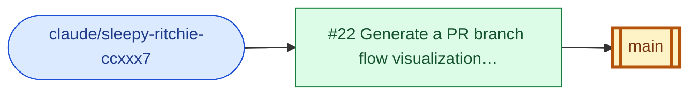

<!-- pr-branch-flow:entry pr=22 — generated by scripts/pr-branch-flow.mjs, do not edit by hand -->
#### PR #22: Generate a PR branch flow visualization for every pull request

| Attribute | Details |
|---|---|
| Repository | VijayKumaro7/landscribe-docs |
| Author | VijayKumaro7 |
| Status | Open |
| Source Branch | `claude/sleepy-ritchie-ccxxx7` (other) |
| Target Branch | `main` (main) |
| Created | 2026-10-30 |
| PR Link | [#22](https://github.com/VijayKumaro7/landscribe-docs/pull/22) |

**PR Branch Flow:**

`claude/sleepy-ritchie-ccxxx7` → `main`

_Source → PR → target. Blue: source branch, amber: target branch; PR colour shows status (green open, purple merged, red closed)._

_Status is as of the last time this entry was generated; the pull request itself is authoritative._
